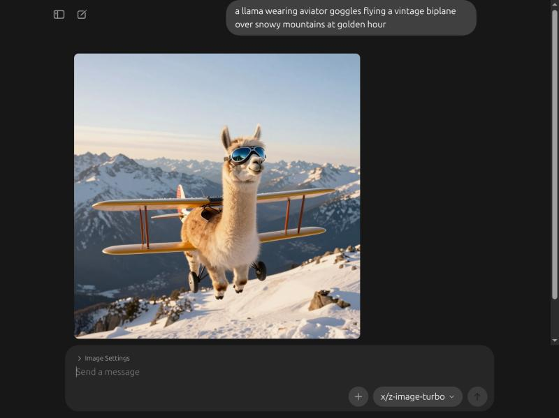

<div align="center">


# Ollama Desktop — Linux (Ubuntu/GTK)

**Native GTK3 + WebKit2GTK desktop app for [Ollama](https://ollama.com) on Linux.**

[](https://github.com/johnohhh1/ollama-webchat-ubuntu)
[](https://gtk.org)
[](https://webkitgtk.org)
[](https://golang.org)
[](https://ollama.com)
[](LICENSE)

This is a Linux port of the official Ollama desktop app (from the main [ollama/ollama](https://github.com/ollama/ollama) repo).  
The official app ships Windows and macOS binaries only. **This port removes that restriction.**

**Tested on:** Ubuntu 26.04 · GNOME 50 · Wayland · NVIDIA RTX 5070



<sub>Ollama v0.40.16 chat UI with local image generation (Z-Image-Turbo, ~22 s on an RTX 5070)</sub>

</div>

---

## What it is

- A GTK3 window containing a WebKit2GTK browser rendering Ollama's React frontend
- Talks to your existing Ollama service at `localhost:11434` — does **not** start or manage the Ollama daemon
- Full chat UI: model selection, file attachments, settings, chat history (SQLite)
- Single-instance lockfile (stale locks are cleaned up automatically), zenity file/folder dialogs, dark mode
- System tray icon (AppIndicator) — close to tray, reopen from the panel
- Wayland-native — no XWayland required
- Migrates your existing chat history (`~/.ollama/db.sqlite`) from older versions automatically
- **Optional image generation** on NVIDIA GPUs: pick an image model in the chat and get a picture back (see below)

---

## Quick install (prebuilt binary)

Grab `ollama-app` from the [latest release](https://github.com/johnohhh1/ollama-webchat-ubuntu/releases/latest), then:

```bash
sudo apt install libwebkit2gtk-4.1-0 libgtk-3-0 libayatana-appindicator3-1 zenity
chmod +x ollama-app
sudo mv ollama-app /usr/local/bin/
ollama-app
```

Prefer to build it yourself? Read on.

---

## Prerequisites

### Runtime

```bash
sudo apt install libwebkit2gtk-4.1-0 libgtk-3-0 libayatana-appindicator3-1 zenity
```

### Build

```bash
sudo apt install \
    libwebkit2gtk-4.1-dev libgtk-3-dev libayatana-appindicator3-dev \
    golang-go nodejs npm \
    pkg-config git
```

> Go 1.21+ required. Check with `go version`.

---

## Build & Install

```bash
git clone https://github.com/johnohhh1/ollama-webchat-ubuntu.git
cd ollama-webchat-ubuntu
bash build.sh
```

The script will:
1. Clone ollama at the pinned tag
2. Apply the Linux port patch
3. Build the React frontend (`npm run build`)
4. Compile the Go binary

The binary lands at `build/ollama-app`. Install it:

```bash
sudo cp build/ollama-app /usr/local/bin/ollama-app
```

---

## Usage

Make sure Ollama is running:

```bash
ollama serve   # or: sudo systemctl start ollama
```

Launch the app:

```bash
ollama-app
```

### Add it to your app launcher

```bash
mkdir -p ~/.local/share/applications ~/.local/share/icons
curl -fsSL -o ~/.local/share/icons/ollama-app.png \
  https://raw.githubusercontent.com/johnohhh1/ollama-webchat-ubuntu/main/assets/Ohhhllama.png
cat > ~/.local/share/applications/ollama-app.desktop <<DESKTOP
[Desktop Entry]
Name=Ollama
Comment=Chat with local LLMs
Exec=/usr/local/bin/ollama-app
Icon=$HOME/.local/share/icons/ollama-app.png
Terminal=false
Type=Application
Categories=Utility;Development;
DESKTOP
```

### Stale lockfile

The app removes stale locks left by a crashed instance on its own. If it still refuses to start, clear the lock manually:

```bash
rm -f ~/.ollama/app.lock && ollama-app
```

---

## Image generation (optional)

Upstream Ollama dropped its experimental image API, so this port ships its own small runner: a Python service (`src/imagegen/imagegen_server.py`, PyTorch + diffusers) on `127.0.0.1:11435`. When it's running, its models show up in the model picker next to your Ollama models. Pick one, type a prompt, and the image appears in the chat. When it isn't running, the app behaves exactly as before.

**Requirements:** NVIDIA GPU, [uv](https://docs.astral.sh/uv/), ~3 GB for Python packages, and 25–35 GB per model (downloaded from Hugging Face on first use).

```bash
bash src/imagegen/install.sh
```

This creates a venv in `~/.local/share/ollama-imagegen`, installs the runner as a systemd user service (`ollama-imagegen`), and starts it.

```bash
journalctl --user -u ollama-imagegen -f
```

**Models** live in `~/.config/ollama-imagegen/models.json`:

```json
{
  "x/z-image-turbo": { "source": "Tongyi-MAI/Z-Image-Turbo", "guidance": 0.0, "steps": 8 },
  "x/flux2-klein":   { "source": "black-forest-labs/FLUX.2-klein-base-4B" }
}
```

| Key | Meaning |
|---|---|
| `source` | Hugging Face repo, or a local `.safetensors` path with `"type": "checkpoint"` |
| `guidance` | CFG scale (default 3.5; turbo models want 0) |
| `steps` | Default steps when the request doesn't set them |
| `offload` | `model` (fast; largest component must fit in VRAM) or `sequential` (fits big models in small VRAM). `model` falls back to `sequential` automatically on out-of-memory |

Idle models are unloaded after 10 minutes (`--keep-alive SECONDS` in the service file; `0` keeps them loaded).

**Tested:** Z-Image-Turbo, 1024×1024, 8 steps, RTX 5070 12 GB: about 22 s per image with sequential offload.

Set `OLLAMA_IMAGEGEN_HOST` before launching the app to point it at a runner elsewhere.

---

## How the port works

The upstream `app/` directory was gated with `//go:build windows || darwin` on ~40 files. The underlying C webview library (`webview.h`) already has full GTK/WebKit2GTK Linux support built in — only the Go build tags were blocking Linux compilation.

### Changes made

| File / Area | Change |
|---|---|
| ~40 `app/**/*.go` files | Build tag: `windows \|\| darwin` → `windows \|\| darwin \|\| linux` |
| `app/webview/webview.go` | Added Linux CGo flags: `WEBVIEW_GTK`, `gtk+-3.0`, `webkit2gtk-4.1` |
| `app/cmd/app/app_linux.go` | GTK window management, lockfile single-instance, signal cleanup |
| `app/cmd/app/tray_linux.go` | System tray indicator via Ayatana AppIndicator3 |
| `app/cmd/app/webview_linux.go` | Webview struct + JS bindings (show/hide/drag/zoom/file picker) |
| `app/cmd/app/filepicker_linux.go` | zenity directory and multi-file choosers |
| `app/server/server_linux.go` | Health-check only — never spawns a process, uses existing systemd service |
| `app/updater/updater_linux.go` | All no-ops — no auto-update on Linux |
| `app/dialog/dlgs_linux.go` | zenity dialogs (yes/no, info, error, file open/save) |
| `app/ui/imagegen.go` + `patches/image-generation.patch` | Image models from the local runner: model list, chat routing, image events, frontend |
| `app/ui/app/src/components/ChatSidebar.tsx` | Settings link was `isWindows`-gated; fixed to show on Linux too |

---

## Known issues

### Claude Desktop / Codex integrations

These are macOS-only upstream and are hidden on Linux.

### EGL warnings on startup

On NVIDIA proprietary drivers you'll see Mesa EGL warnings — these are **harmless**. WebKit falls back to Cairo software rendering for the compositor. For a chat UI this is imperceptible.

```
libEGL warning: egl: failed to create dri2 screen
libEGL warning: pci id for fd N: 10de:XXXX, driver (null)
```

---

## Compatibility

| Distro | GTK | WebKit | Status |
|--------|-----|--------|--------|
| Ubuntu 26.04 | 3.24 | 4.1 | Tested |
| Ubuntu 24.04 | 3.24 | 4.1 | Should work |
| Fedora 40+ | 3.24 | 4.1 | Should work |
| Arch Linux | 3.24 | 4.1 | Should work |

> Requires `webkit2gtk-4.1`. Ubuntu 22.04 ships `4.0` only — not compatible without a PPA.

---

## License

The Ollama desktop app source is MIT licensed (see [ollama/ollama](https://github.com/ollama/ollama)). The Linux port files in this repo are also MIT.

---

<div align="center">

If this saved you from running Ollama in a browser tab, a ⭐ helps other Linux folks find it.

</div>
